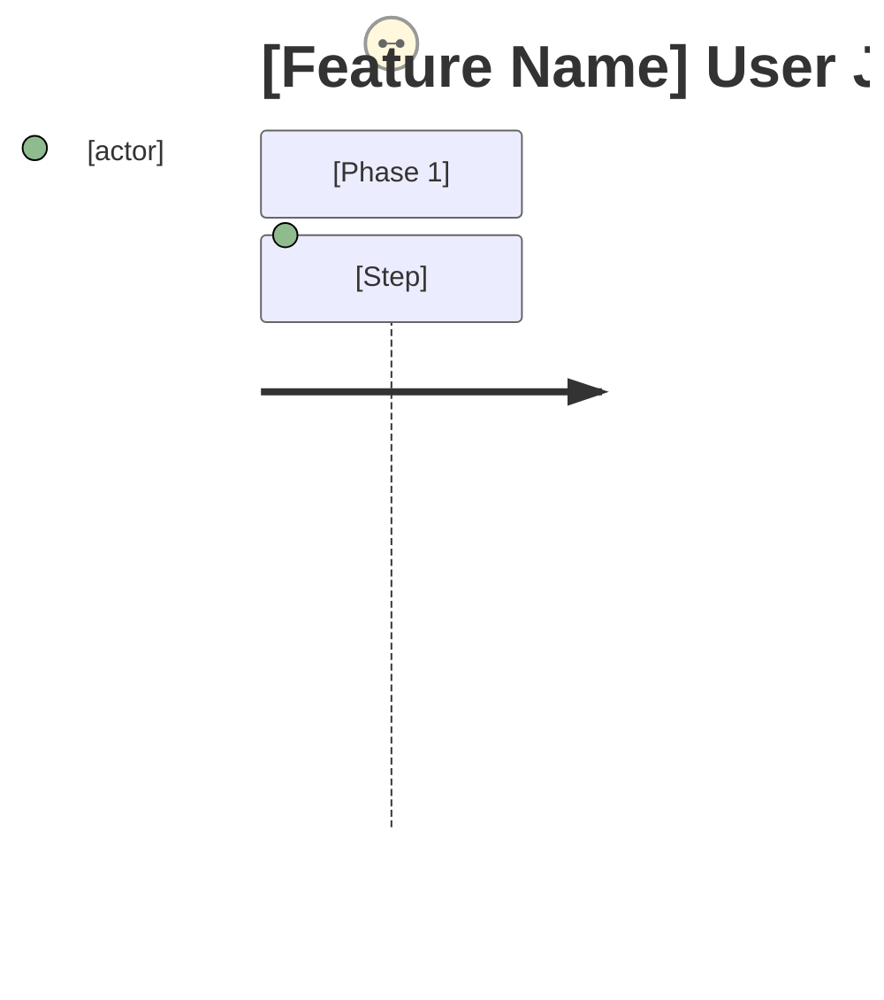

# PRD: [Feature Name]

## Overview

### One-line Summary
[Describe this feature in one line]

### Background
[Why is this feature needed? What problem does it solve?]

## User Stories

### Primary Users
[Define the main target users]

### User Stories
```
As a [user type]
I want to [goal/desire]
So that [expected value/benefit]
```

### Use Cases
1. [Specific usage scenario 1]
2. [Specific usage scenario 2]
3. [Specific usage scenario 3]

### User Journey Diagram (When Needed)

[Include when prose does not make the material user flow clear; otherwise remove this subsection.]

[Map the end-to-end user experience from trigger event to goal completion]

### Scope Boundary Diagram (When Needed)

[Include when prose does not make the material in-scope/out-of-scope relationship clear; otherwise remove this subsection.]
```mermaid
C4Context
    Boundary(scope, "In Scope") {
        [Components in scope]
    }
    Boundary(out, "Out of Scope") {
        [Components out of scope]
    }
```
[Clarify what is and is not included in this feature]

## Functional Requirements

### MVP

The smallest coherent behavior or journey that delivers the value stated above. Every requirement here survived removal: taking it out breaks the value or a required legal, contractual, security, or compatibility obligation.

- [ ] Requirement 1: [Detailed description]
  - AC-001: [Acceptance criteria - Given/When/Then format or measurable standard]
  - AC-002: [Acceptance criteria]
  - Removal result: [What breaks without it — the value or the named obligation]
- [ ] Requirement 2: [Detailed description]
  - AC-003: [Acceptance criteria]
  - Removal result: [What breaks without it]

### Out of Scope

User-authored non-goals and current exclusions needed to make the MVP boundary executable. Evaluation requests, speculative ideas, and unselected possibilities remain only in active convergence context.

`Origin` distinguishes a user-authored non-goal (`user`) from a current exclusion needed to make the MVP boundary executable (`analysis`). Record `None — user confirmed there are none` when the user considered exclusions and found none.

- Item 1: [Description and reason for exclusion] — Origin: user | analysis

## Non-Functional Requirements

Record a quality level only when the user's wording or an accepted organizational, legal, or contractual source states it. Leave other attributes out; the Design Doc selects the lowest level that still delivers the outcome.

- **[Quality attribute]**: [level] - Source: [user wording or accepted source]

### Accessibility (when feature includes UI)
- Compliance standard (when established by an accepted organizational, legal, contractual, or user-supplied source): [standard]
- Target assistive technologies: [Screen reader, keyboard operation, voice control, etc.]
- Platform requirements: [e.g., app store review requirements]
- Known constraints: [e.g., external library limitations]

## Success Criteria

**Outcome**: [the one observable result this feature must produce — every metric below measures progress toward it]

Include only quantitative and UI targets that a governing requirement or existing evidence supplies. The entries below show optional shapes, not a required metric count.

### Quantitative Metrics
- [Metric name]: [numeric target] measured by [method] within [timeframe]

### Qualitative Metrics
- [Observable user experience result]

### UI Quality Metrics (when feature includes UI)
- [Key operation completion rate, error recovery rate, or accessibility audit score]

## Technical Considerations

### Dependencies
- [Dependencies on existing systems]
- [Dependencies on external services]

### Constraints
- [Technical constraints]
- [Resource constraints]

### Assumptions
- [Prerequisite requiring validation 1]
- [Prerequisite requiring validation 2]

### Risks and Mitigation
Include only evidenced product risks that can change scope, success criteria, or acceptance.

| Risk | Impact | Probability | Mitigation |
|------|--------|-------------|------------|
| [Risk 1] | High/Medium/Low | High/Medium/Low | [Countermeasure] |
| [Risk 2] | High/Medium/Low | High/Medium/Low | [Countermeasure] |

## Undetermined Items

- [ ] [Question 1]: [Description of options or impacts]
- [ ] [Question 2]: [Description of options or impacts]

*Resolve only items that block the current document or the next decision, with the user when they own it. Keep non-blocking unknowns with their effect; in as-is documentation, unknown business intent is not a reason to invent requirements. Delete this section when it is empty*

## Appendix

### References
- [Related document 1]
- [Related document 2]

### Glossary
- **Term 1**: [Definition]
- **Term 2**: [Definition]
