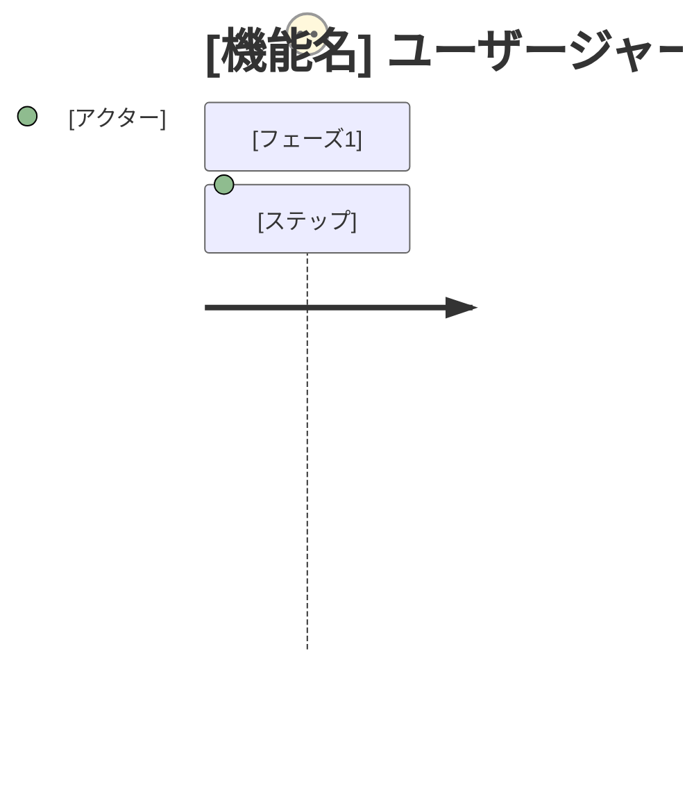

# PRD: [機能名]

## 概要

### 一言まとめ
[この機能を一言で説明]

### 背景
[なぜこの機能が必要か？どのような問題を解決するか？]

## ユーザーストーリー

### 主要ユーザー
[主なターゲットユーザーを定義]

### ユーザーストーリー
```
[ユーザー種別]として
[目標/願望]をしたい
なぜなら[期待する価値/メリット]だから
```

### ユースケース
1. [具体的な利用シナリオ1]
2. [具体的な利用シナリオ2]
3. [具体的な利用シナリオ3]

### ユーザージャーニー図（必要な場合）

[散文では重要なユーザーフローが明確にならない場合に含める。不要なら本サブセクションごと削除する。]

[トリガーイベントから目標達成までのエンドツーエンドのユーザー体験をマッピング]

### スコープ境界図（必要な場合）

[散文では重要なスコープ内外の関係が明確にならない場合に含める。不要なら本サブセクションごと削除する。]
```mermaid
C4Context
    Boundary(scope, "スコープ内") {
        [スコープ内のコンポーネント]
    }
    Boundary(out, "スコープ外") {
        [スコープ外のコンポーネント]
    }
```
[この機能に含まれるものと含まれないものを明確化]

## 機能要件

### MVP

上記の価値を届ける、最小のまとまった振る舞い・ジャーニー。ここに残るのは、取り除くと価値、または必要な法務・契約・セキュリティ・互換性の義務が成立しなくなる要件だけである。

- [ ] 要件1: [詳細説明]
  - AC-001: [受入条件 - Given/When/Then形式または測定可能な基準]
  - AC-002: [受入条件]
  - 除外した場合: [これがないと成立しなくなるもの — 価値、または該当する義務]
- [ ] 要件2: [詳細説明]
  - AC-003: [受入条件]
  - 除外した場合: [これがないと成立しなくなるもの]

### Out of Scope

ユーザーが明示した除外事項と、MVPの境界を実装判断に使える形で定めるために必要な現在の除外を記録する。評価依頼、推測的なアイデア、未選択の可能性は収束中のコンテキストに留める。

`Origin` は、ユーザーが明示した除外事項（`user`）と、MVP境界を実装判断に使える形にするために必要な現在の除外（`analysis`）を区別する。ユーザーが除外を検討した結果そうしたものがなかった場合は `None — 除外すべきものはないとユーザーが確認` と記載する。

- 項目1: [説明と除外理由] — Origin: user | analysis

## 非機能要件

品質水準は、ユーザーの文言、または承認済みの組織・法務・契約上の出典が述べている場合に限って記録する。それ以外の特性は記載せず、成果を届けられる最も低い水準をDesign Docが選択する。

- **[品質特性]**: [水準] — 出典: [ユーザーの文言または承認済みの出典]

### アクセシビリティ（UI機能を含む場合）
- 準拠基準（承認済みの組織・法務・契約上の出典、またはユーザーが示した出典で定められている場合）: [基準]
- 対象支援技術: [スクリーンリーダー、キーボード操作、音声制御等]
- プラットフォーム要件: [例: アプリストア審査要件]
- 既知の制約: [例: 外部ライブラリの制限]

## 成功基準

**Outcome**: [この機能が生むべき観測可能な結果を1つ — 以下の各指標はこれに向けた進捗を測る]

要件または既存のエビデンスが示す定量目標とUI目標だけを記載する。以下は任意の形の例であり、必要な指標の数を示すものではない。

### 定量的指標
- [指標名]: [数値目標] を [測定方法] で [期間] 以内に達成

### 定性的指標
- [観測可能なユーザー体験の結果]

### UI品質指標（UI機能を含む場合）
- [主要操作完了率、エラー回復率、またはアクセシビリティ監査スコア]

## 技術的考慮事項

### 依存関係
- [既存システムへの依存]
- [外部サービスへの依存]

### 制約
- [技術的な制約]
- [リソースの制約]

### 前提条件
- [確認が必要な前提1]
- [確認が必要な前提2]

### リスクと対策
スコープ、成功基準、受入条件を変えうる、根拠のあるプロダクトリスクだけを記載する。

| リスク | 影響度 | 発生確率 | 対策 |
|-------|-------|---------|-----|
| [リスク1] | 高/中/低 | 高/中/低 | [対策] |
| [リスク2] | 高/中/低 | 高/中/低 | [対策] |

## 未決定事項

- [ ] [質問1]: [選択肢や影響の説明]
- [ ] [質問2]: [選択肢や影響の説明]

*現在のドキュメントまたは次の判断を止める項目だけを、ユーザーが判断する場合はユーザーと解決する。止めない不明点はその影響とともに残す。現状ドキュメントでは、不明な業務上の意図を理由に要件を作らない。空になったらこのセクションを削除*

## 付録

### 参考資料
- [関連ドキュメント1]
- [関連ドキュメント2]

### 用語集
- **用語1**: [定義]
- **用語2**: [定義]
