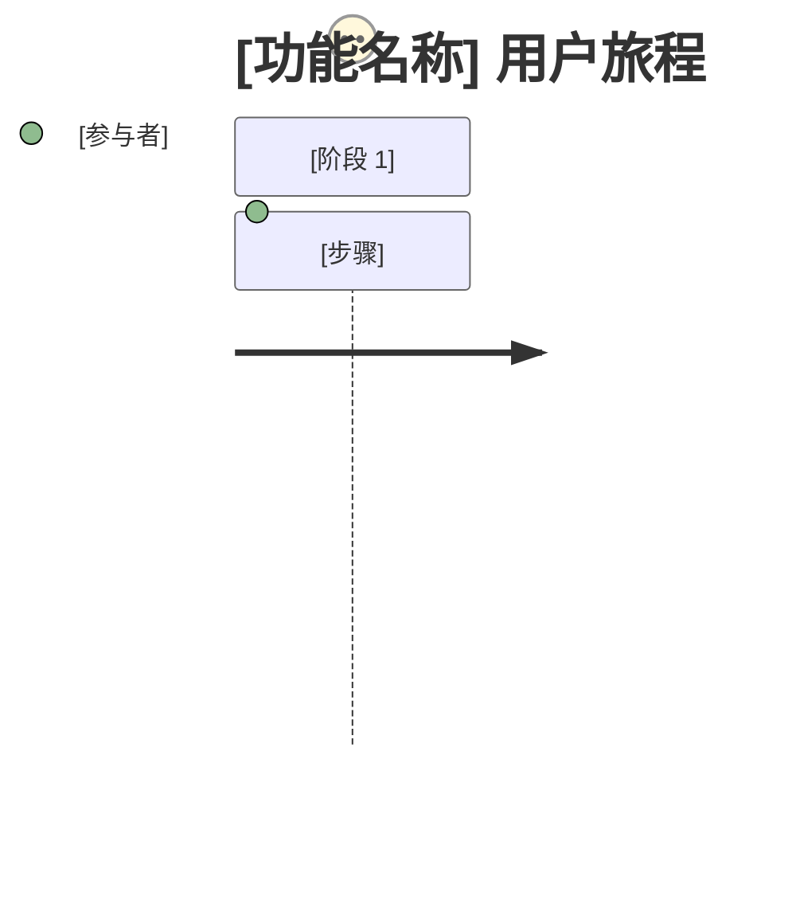

# PRD: [功能名称]

## 概述

### 一句话摘要
[用一句话描述该功能]

### 背景
[为什么需要该功能？它解决了什么问题？]

## 用户故事

### 主要用户
[定义主要目标用户]

### 用户故事
```
作为[用户类型]
我想要[目标/需求]
以便[预期价值/收益]
```

### 使用场景
1. [具体使用场景 1]
2. [具体使用场景 2]
3. [具体使用场景 3]

### 用户旅程图（按需）

[当文字说明无法清晰呈现关键用户流程时才包含此小节，否则删除该小节。]

[从触发事件到目标完成，梳理端到端的用户体验]

### 范围边界图（按需）

[当文字说明无法清晰呈现范围内/范围外之间的关键关系时才包含此小节，否则删除该小节。]
```mermaid
C4Context
    Boundary(scope, "范围内") {
        [范围内组件]
    }
    Boundary(out, "范围外") {
        [范围外组件]
    }
```
[明确该功能包含什么、不包含什么]

## 功能需求

### MVP

能交付上述价值的最小连贯行为或流程。这里的每一项需求都经受住了移除测试：去掉它会破坏该价值，或破坏某项必须遵守的法律、合同、安全或兼容性义务。

- [ ] 需求 1：[详细描述]
  - AC-001：[验收标准 - Given/When/Then 格式或可衡量的标准]
  - AC-002：[验收标准]
  - 移除后果：[缺少它会破坏什么——该价值还是所指明的义务]
- [ ] 需求 2：[详细描述]
  - AC-003：[验收标准]
  - 移除后果：[缺少它会破坏什么]

### 范围外

用户明确提出的非目标，以及为使 MVP 边界可执行而需要的当前排除项。评估请求、设想性想法和未被选中的可能性，只保留在进行中的收敛过程上下文中。

“来源”用于区分用户明确提出的非目标（`user`）与为使 MVP 边界可执行而需要的当前排除项（`analysis`）。若用户考虑过排除项但认为没有，记录为“无——用户已确认没有此类项”。

- 条目 1：[描述及排除原因] — 来源：user | analysis

## 非功能需求

仅当用户的原话或已接受的组织、法律、合同来源规定了质量水平时才记录。其他属性不写入；由设计文档选定仍能达成成果的最低水平。

- **[质量属性]**：[水平] — 来源：[用户原话或已接受的来源]

### 无障碍性（功能包含 UI 时）
- 合规标准（由已接受的组织、法律、合同来源或用户提供的来源规定时）：[标准]
- 目标辅助技术：[屏幕阅读器、键盘操作、语音控制等]
- 平台要求：[例如应用商店审核要求]
- 已知限制：[例如外部库的限制]

## 成功标准

**结果**：[该功能必须产生的那一个可观测结果——下面的每个指标都衡量朝该结果推进的进度]

仅填写由约束性需求或既有依据给出的定量目标与 UI 目标。以下条目只是可选的形式示例，并不代表必需的指标数量。

### 定量指标
- [指标名称]：在[时间范围]内通过[测量方法]达到[数值目标]

### 定性指标
- [可观测的用户体验结果]

### UI 质量指标（功能包含 UI 时）
- [关键操作完成率、错误恢复率或无障碍审计分数]

## 技术考量

### 依赖项
- [对现有系统的依赖]
- [对外部服务的依赖]

### 约束条件
- [技术约束]
- [资源约束]

### 假设条件
- [需要验证的前提条件 1]
- [需要验证的前提条件 2]

### 风险与缓解措施
仅填写有依据、且可能改变范围、成功标准或验收的产品风险。

| 风险 | 影响 | 概率 | 缓解措施 |
|------|--------|-------------|------------|
| [风险 1] | 高/中/低 | 高/中/低 | [缓解措施] |
| [风险 2] | 高/中/低 | 高/中/低 | [缓解措施] |

## 待定事项

- [ ] [问题 1]：[选项或影响的描述]
- [ ] [问题 2]：[选项或影响的描述]

*仅解决会阻塞当前文档或下一项决策的事项，归用户决定的与用户一起解决。不造成阻塞的未知项连同其影响保留；在现状文档中，未知的业务意图不能成为编造需求的理由。本节为空时将其删除*

## 附录

### 参考资料
- [相关文档 1]
- [相关文档 2]

### 术语表
- **术语 1**：[定义]
- **术语 2**：[定义]
